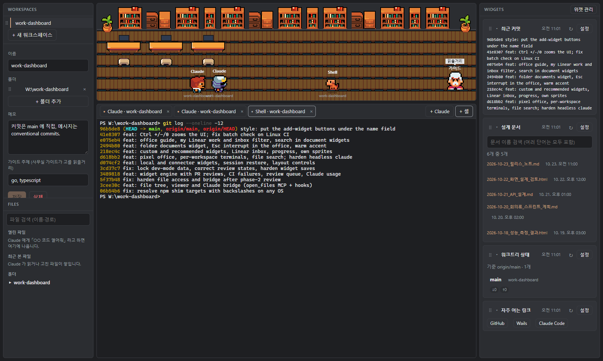

# work-dashboard



**[한국어](#한국어) · [English](#english)**

---

## 한국어

Claude Code 사용자를 위한 가벼운 데스크톱 업무 대시보드입니다.
[Munder Difflin](https://github.com/HarnessMD/munder-difflin) 에서 영감을 받아 작게 다시 만들었습니다 —
Electron 앱 대신 Windows 실행 파일 하나(약 13 MB, Wails + 시스템 WebView2)입니다.

### 무엇을 하나요

- **워크스페이스** — 함께 작업하는 폴더들을 묶습니다. **+ Claude** 는 첫 폴더에서 `claude` 를 열고 나머지는
  `--add-dir` 로 넘기며, 워크스페이스 메모를 `--append-system-prompt-file` 로 전달합니다. **+ 셸** 은 PowerShell 을 엽니다.
- **터미널 + 파일 트리** — 터미널이 앱 안에 있고, Claude 에게 「○○ 코드 열어줘」 라고 하면 그 파일이 트리와 뷰어에 열립니다.
  파일 이름·경로 검색도 됩니다. 앱을 다시 켜면 열려 있던 Claude 대화를 이어서 열 수 있습니다.
- **켜고 끄는 위젯**
  - PR 리뷰 현황, CI 실패 PR, 리뷰 요청 큐 (GitHub CLI)
  - Linear 내 이슈(할 일 → 진행 중 → 리뷰·확인 중으로 묶음), Linear 알림(나를 부르거나 내가 담당인 것만), Notion 명세 —
    Claude Code 에 이미 연결한 커넥터를 읽기 전용 도구로만 씁니다. 토큰을 따로 발급하지 않아도 됩니다.
  - 배포·스왑 대기, 워크트리 상태, QA 실행, Claude 한도·로그인, 세션 복원
  - 직접 만드는 위젯 (여러 개 추가 가능): **명령 출력**(셸 없이 실행), **링크 모음**, **폴더 문서**(최근 수정 순, 누르면 기본 앱으로 열기)
  - 문서 위젯(폴더 문서·Notion 명세·QA 보고서)에는 검색창이 있습니다
  - 「Claude 에게 추천받기」 에 원하는 것을 적으면 맞는 위젯을 골라 줍니다 (Claude 는 도구 없이 추천만 합니다)
- **도트 사무실** — Claude 세션마다 캐릭터가 하나씩 있고, 훅 이벤트에 따라 책상에서 일하거나 돌아다닙니다.
  진행률과 지금 쓰는 도구가 머리 위에 보이고, 누르면 그 터미널로 갑니다.
  오른쪽 아래 **가이드** 를 누르면 워크스페이스 기술(go.mod, package.json, pubspec.yaml … 을 보고 판단)에 맞는
  기술 블로그를 엽니다. 사이드바의 「가이드 주제」 로 직접 정할 수 있고, 찾지 못하면 AI 관련 사이트를 엽니다.
- **화면 확대** — Ctrl + / Ctrl − / Ctrl 0, 패널 폭은 드래그로 조절합니다.

### 필요한 것

- Windows 10/11 (WebView2 런타임은 Windows 11 에 기본 포함)
- 데이터 위젯용 [Claude Code](https://claude.com/claude-code) 와 [GitHub CLI](https://cli.github.com/)

### 내 데이터

이 레포에는 개인 정보가 없습니다. 워크스페이스와 설정은 사용자별로 `~/.work-dashboard/` 에 저장됩니다
(`workspaces/<id>.json`, `notes/<id>.md`). 토큰은 저장하지 않습니다.
`WD_DATA_DIR=<절대 경로>` 로 다른 데이터 폴더를 쓸 수 있습니다 (데모·스크린샷용).

### 내 캐릭터 쓰기

사무실은 CC0 Ninja Adventure 캐릭터를 씁니다. 쓸 권리가 있는 다른 그림을 쓰려면
`~/.work-dashboard/characters/*.png` 에 스프라이트 시트를 넣으세요 (64×112: 아래/위/왼쪽/오른쪽 4열 × 16×16 7행,
0–3행 걷기, 4행 동작). 파일은 내 컴퓨터에만 있습니다.

### 개발

```bash
go install github.com/wailsapp/wails/v2/cmd/wails@v2.10.2
WD_DEV_UNLOCK=1 wails dev               # 라이브 리로드 (없으면 로컬 데이터가 잠깁니다, 아래 참고)
wails build -ldflags "-s -w"           # build/bin/work-dashboard.exe

go test -cover ./...
cd frontend && npm test
```

> **`wails dev` 보안 주의:** Wails 개발 서버는 어느 출처의 웹소켓 호출이든 받기 때문에, 브라우저에 열린 아무 웹 페이지나
> 바인딩된 메서드를 부를 수 있습니다. 그래서 개발 빌드에서는 명령을 실행하거나 로컬 데이터를 돌려주는 메서드가 모두 막혀 있고,
> `WD_DEV_UNLOCK=1` 일 때만 풀립니다. 그동안은 믿을 수 없는 사이트를 열지 마세요. 배포 빌드는 해당 없습니다.

---

## English

A lightweight desktop work dashboard for Claude Code users.
Inspired by [Munder Difflin](https://github.com/HarnessMD/munder-difflin), rebuilt small:
a single Windows executable (~13 MB, Wails + the system WebView2) instead of an Electron app.

### What it does

- **Workspaces** — group the folders you work on together. **+ Claude** starts `claude` in the first folder with
  `--add-dir` for the others and the workspace notes via `--append-system-prompt-file`; **+ 셸** opens PowerShell.
- **Terminals + file tree** — embedded terminals; files Claude opens for you ("open the X code") appear in the tree and
  viewer. File name/path search, and Claude conversations that were open can be resumed after a restart.
- **Toggleable widgets**
  - PR reviews, CI failures, review queue (GitHub CLI)
  - My Linear issues (grouped: to do → in progress → in review/test), Linear inbox (only mentions, assignments and my
    own issues), Notion specs — through the connectors you already set up in Claude Code, with read-only tools only.
    No extra API tokens.
  - Deploy/swap status, worktrees, QA runs, Claude usage limits & login, session restore
  - Your own widgets, as many as you like: **command output** (no shell), **links**, **folder documents** (newest first,
    opens with the default app)
  - Document widgets (folder documents, Notion specs, QA reports) have a search box
  - Describe what you want and Claude suggests widgets (Claude gets no tools, it only suggests)
- **Pixel office** — each Claude session is a character that works at a desk or wanders, driven by Claude hooks, with
  progress and the current tool above its head; click it to jump to its terminal. Click the **guide** (bottom right)
  for a tech blog matching the workspace (detected from go.mod, package.json, pubspec.yaml, …, or set by the workspace's
  guide topics), or an AI site when nothing matches.
- **Zoom** — Ctrl + / Ctrl − / Ctrl 0; drag the panel edges to resize.

### Requirements

- Windows 10/11 (the WebView2 runtime ships with Windows 11)
- [Claude Code](https://claude.com/claude-code) and the [GitHub CLI](https://cli.github.com/) for the data widgets

### Local data

Nothing personal lives in this repository. Workspaces and settings are stored per user in `~/.work-dashboard/`
(`workspaces/<id>.json`, `notes/<id>.md`). Tokens are never written there.
Set `WD_DATA_DIR=<absolute path>` to use another data folder (demos, screenshots).

### Your own characters

The office uses the CC0 Ninja Adventure characters. To use other art you are allowed to use, put sprite sheets in
`~/.work-dashboard/characters/*.png` (64×112: 4 columns down/up/left/right × 7 rows of 16×16, rows 0–3 walking,
row 4 action). They stay on your computer.

### Develop

```bash
go install github.com/wailsapp/wails/v2/cmd/wails@v2.10.2
WD_DEV_UNLOCK=1 wails dev               # live reload (local data is locked without it, see below)
wails build -ldflags "-s -w"           # build/bin/work-dashboard.exe

go test -cover ./...
cd frontend && npm test
```

> **Security note for `wails dev`:** the Wails dev server accepts websocket calls from any origin, so any web page open
> in a browser could call the bound methods. Every method that runs commands or returns local data is therefore
> disabled in dev builds unless you start with `WD_DEV_UNLOCK=1`; don't browse untrusted sites while doing so.
> Release builds are not affected.

### Layout

```
main.go, app.go           Wails entry point and the methods bound to the UI
terminals.go, agents.go   terminals, Claude sessions, hook events
widgets.go, localwidgets.go, folderwidget.go, linearfilter.go, recommend.go, guide.go
                          widget data, recommendations, office guide
internal/widget           widget catalog + setting validation
internal/workspace        workspace model + JSON store
internal/term             pseudo-terminal sessions (ConPTY via go-pty)
internal/launch           workspace → claude / shell command lines
internal/bridge           localhost bridge for Claude hooks and the open_files MCP tool
internal/claudeask        headless `claude -p` lookups through connectors
internal/command          no-shell command runner for the command widget
internal/files            file tree, viewer, search (kept inside the workspace)
frontend/                 Vite + TypeScript UI (dark-gray tokens in src/styles/tokens.css)
```

## License

MIT · Characters: [Ninja Adventure](https://pixel-boy.itch.io/ninja-adventure-asset-pack) (CC0), see
`frontend/src/assets/characters/LICENSE.md`.
